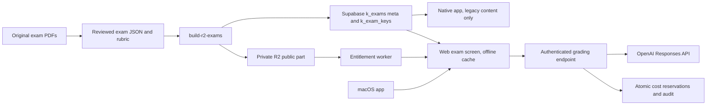

# K-Learning architecture

## Intent & Constraints

Web learning app on Cloudflare Pages, shared Supabase course/exam content and a React Native client. BuSta exams preserve the original assessment and official solutions. Automated marks are training estimates until calibrated against human marks.

## Dependency & Contract Matrix

| Component | Output | Dependencies |
| --- | --- | --- |
| `data/courses-config.js`, `js/courses-db.js` | Catalog and static fallback | `k_courses` |
| `content/exams/*.json` | Versioned source exam content (with solutions) | `scripts/build-r2-exams.mjs` |
| `build/r2-exams/`, `build/sql/` | Public exam files for private R2; metadata and key SQL | R2 bucket, `k_exams`, `k_exam_keys` (ADR 0002) |
| `functions/api/exam-solutions.js` | Model answer/explanation after a saved attempt | `k_exam_keys`, `k_has_course_access` |
| `js/screens/exam.js` | Examination and feedback | authenticated Supabase, grading API |
| `functions/api/grade-answer.js` | Server-side rubric assessment | OpenAI server/BYOK key, `k_grading_jobs`, canonical exam content |
| `desktop/` | Signed macOS web client | live HTTPS app; no API/service key in binary |

## Dependency graph

## Invariants

1. Task text, figures, shared contexts and solutions retain independent source provenance. No official grading scale is invented.
2. The server retrieves question, model answer and rubric from canonical exam content; client-supplied solutions or scores are never trusted by the grading endpoint.
3. Missing/invalid/API-failed assessments are pending, never automatically zero.
4. Secret keys remain in the project vault or protected server configuration.
5. Model scores are bounded and computed from validated criterion marks. Disagreement is shown for review.
6. Existing conflict copies and unrelated user changes are preserved.

## Refactoring guides

Changes to exam JSON must preserve both camelCase source fields and existing web normalization. Any grading change must cover server validation, cost reservations, web persistence and pending/review UI. See `docs/adr/0001-busta-grading.md`.
